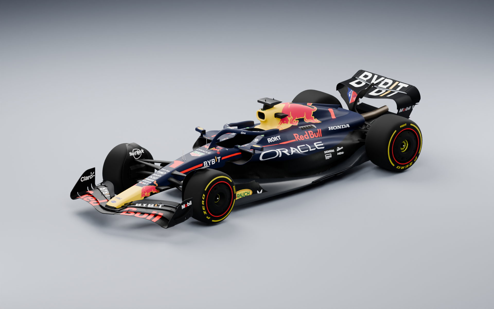
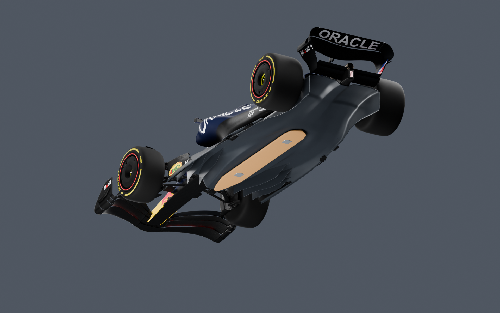
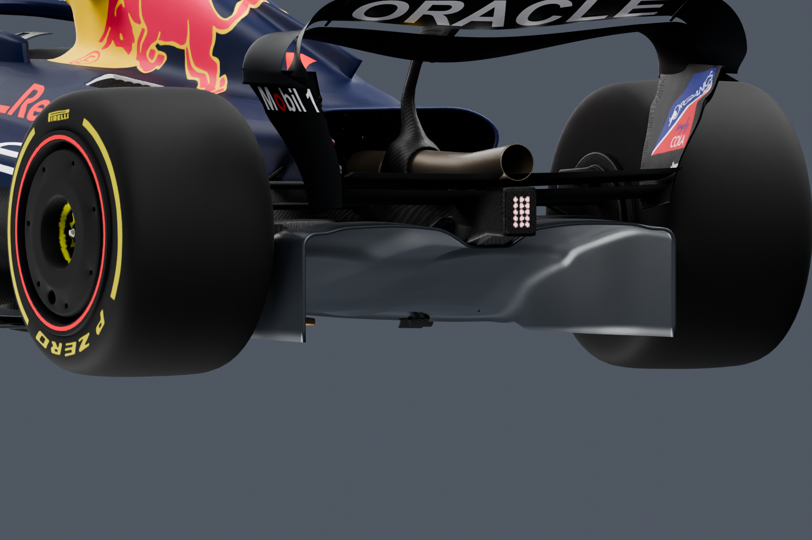
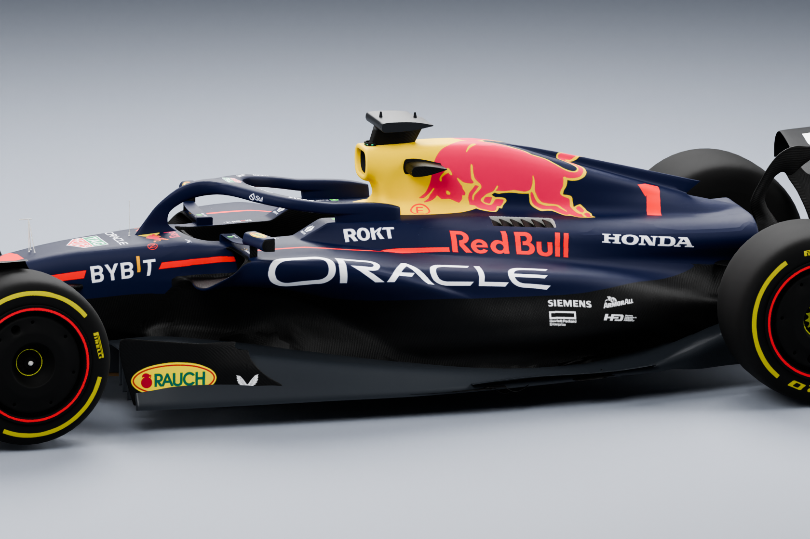
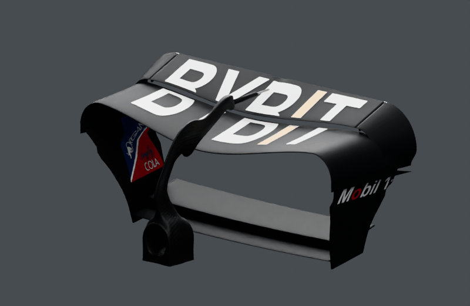
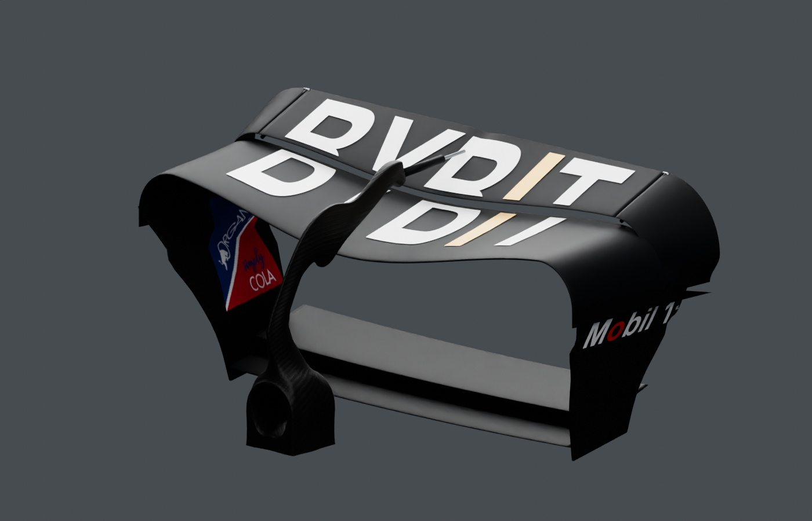
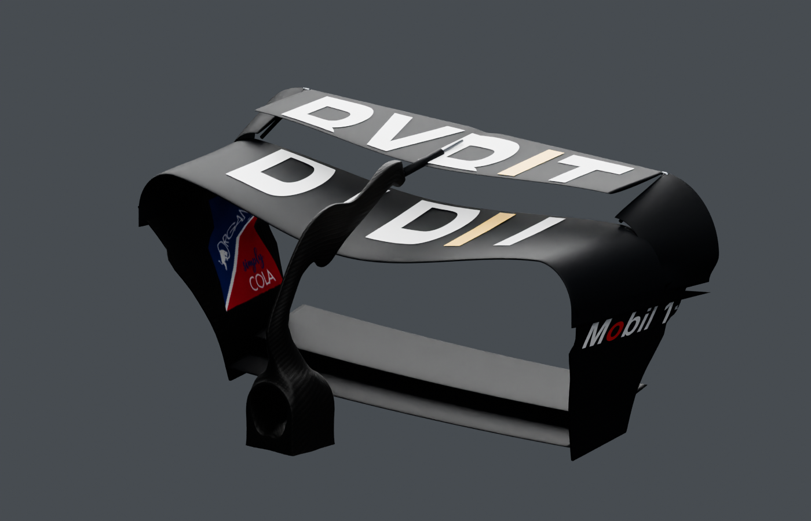
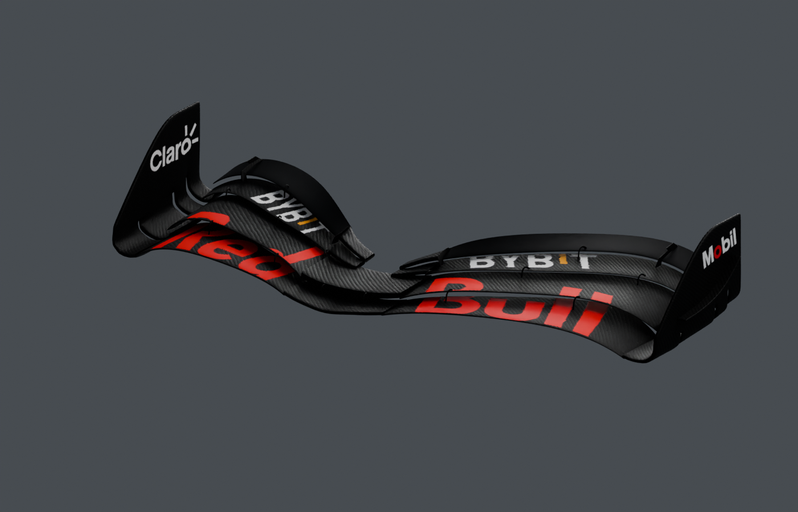
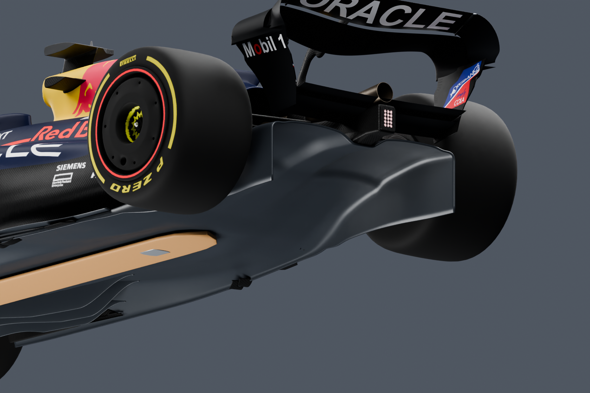
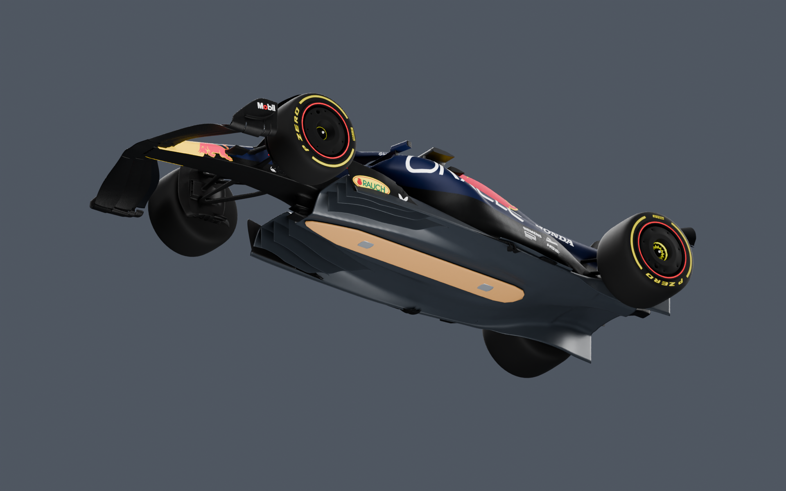

# RB19 CFD Lab

**Photo-informed RB19 geometry, continuous underfloor/diffuser and working Blender DRS, co-designed and developed by Phoom & OpenAI Codex.** The OpenFOAM virtual wind tunnel remains in preparation.



*Modified from [Redgrund's “Oracle Red Bull F1 Car RB19 2023”](https://sketchfab.com/3d-models/oracle-red-bull-f1-car-rb19-2023-e4afe46f3aab4b23a418da06fc163821), [CC BY 4.0](https://creativecommons.org/licenses/by/4.0/). Model-derived images and animation retain that license. [Attribution and changes](ATTRIBUTION.md).*

## Latest underbody reconstruction



The floor now runs continuously from the inlet through a throat into a stepped,
curved diffuser. Six internal swept inlet vanes and two floor-edge blades were
built, the sidepod undercut and lower waist were deepened, and the diffuser wall
was narrowed around the retained brake fins. Original UVs, BYBIT livery and the
DRS assembly are retained.

The nine new closed components pass independent topology and self-intersection
checks. Their **182,488-triangle underbody-only union** passes OpenFOAM
`surfaceCheck -checkSelfIntersection`. Six underfloor paths and two sidepod bypass
paths are geometrically open in the saved native file; the smallest sampled
distance to a solid is **25.56 mm**. These are geometric probes, not simulated
streamlines or proof of attached flow.

| Diffuser mouth | Sidepod undercut |
|---|---|
|  |  |

The reconstruction combines Monaco underside, Spain diffuser and Hungary
sidepod photographs. It is not one verified race specification or team CAD.
Dimensions, an 8 mm modeled floor thickness and ride-height setup remain
assumptions. [References and decisions](docs/underbody-references.md) ·
[Underbody evidence](evidence/underbody-summary.json) ·
[Assumed section stations](src/underbody_stations.json).

## Working DRS



This animation contains actual frames rendered from the saved Blender project. Only the upper flap, its markings and moving actuator lug rotate about the fixed hinge; the mainplane, endplates, swan-neck and beam wing stay fixed. A telescopic link follows the moving lug. BYBIT remains on the forward/top wing surfaces with a gold I; ORACLE is on the rear flap.

The wing-only animation and detail images were retained from the preceding delivery; exact wing geometry is unchanged. The single local `RB19.blend` contains `CTRL_DRS` with a 0–1 custom property. Frame 1/120 is closed and frame 60 is open; the timeline plays a four-second demonstration. No addon is required.

## Current evidence

Snapshot: **18 October 2026**. The new underbody and sidepod geometry is delivered. The previously reconstructed front/rear wings are unchanged; DRS was checked again at 16 positions after reopening the current native file. Exact race-car dimensions and aerodynamic performance are not established.

| Check | Observed result |
|---|---|
| New wing geometry | 14 closed components: eight front elements, mainplane, flap, two rolled tips and two beam elements |
| Component topology | Watertight, consistent winding, positive volume and zero self-intersection pairs in independent checks |
| Native file | Reopened with packed textures; returns to the same closed state |
| DRS motion | 16 sampled states; no moving-flap crossings with the checked fixed wing bodies |
| Rear slot | 39 sampled sections per state: closed **17.08–22.04 mm**, open **66.38–81.99 mm** |
| Front slots | 54 sampled sections; minimum sampled gap **7.18 mm** |
| Whole-car CFD surface | **Requires a fresh state-specific export, transition repair and union** |
| Volume mesh and solver | No accepted mesh or aerodynamic solution for the current car |

The sampled checks are not a continuous clearance proof or FIA compliance certification. The previous repaired CFD surface and **3,154,323-cell checkpoint belong to older geometry**. They cannot be reused as current acceptance evidence. [Status and acceptance criteria](docs/status.md) · [Compact evidence](evidence/README.md).

## Geometry views

| DRS closed | DRS open |
|---|---|
|  |  |



| Diffuser | Underfloor |
|---|---|
|  |  |

[Full-car side](assets/side.png) · [Rear view](assets/rear.png) · [Front view](assets/front.png)

## Planned flow setup

The local OpenFOAM 14 workflow is configured for a **50 m/s** inlet, moving ground and rotating-wheel wall conditions. State-specific surface validation, a fresh mesh, resolved wing passages, wall treatment, residuals, mass balance and force stability must pass before reporting aerodynamic results. The 1.5 m² reference area is an assumed comparison convention.

The workflow includes finite job memory/swap limits, Windows-host headroom checks, stage checkpoints and evidence gates. [Engineering notes](docs/engineering.md) explain these distinctions.

## Explore the repository

- [Contribution and co-development credits](CONTRIBUTIONS.md)
- [Model provenance and licenses](ATTRIBUTION.md)
- [Current status](docs/status.md)
- [Runnable MPI checkpoint parser](src/checkpoint_log.py) and [its tests](tests/test_checkpoint_log.py)

Run the public parser example with Python 3.10 or later:

```bash
python -m unittest discover -s tests -v
```

This is a curated portfolio. The large native model, full machine-specific workflow, mesh checkpoints and third-party reference photographs remain local. Parser tests do not run or validate CFD.

## Credits and scope

**Phoom & OpenAI Codex co-designed and developed the project-specific modifications, automation, validation and presentation.** Redgrund created the base artist model. Red Bull Racing designed the real RB19.

This independent study is not official team CAD and does not imply endorsement by Red Bull Racing, Formula 1, the artist or sponsors. [Code and model-image licensing](LICENSES.md).
