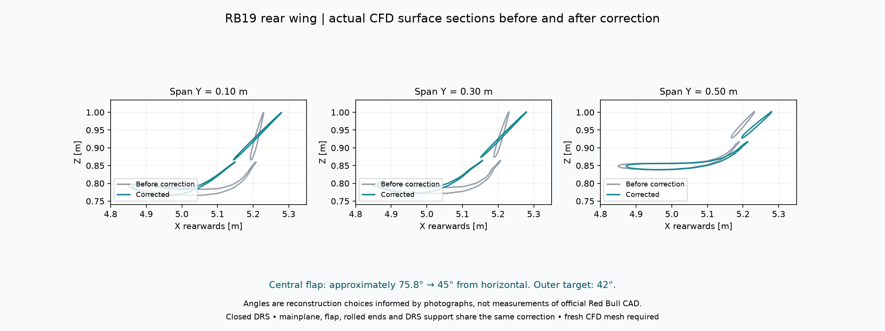
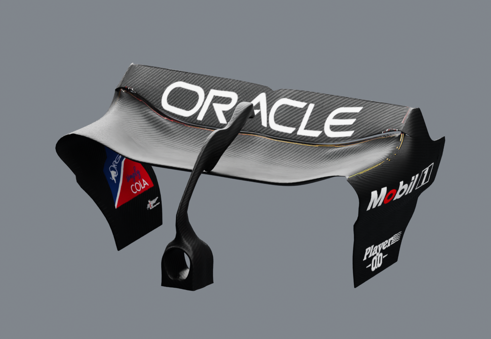

# RB19 CFD Lab

**Geometry refinement, verification, and a resource-bounded virtual wind tunnel — co-designed and developed by Phoom & OpenAI Codex.**

This project adapts an attributed RB19 artist model into a detailed Blender study and an OpenFOAM 14 workflow. It documents both the geometry work and the engineering needed to preserve progress on a memory-constrained workstation.


*Project render of a modified model based on [Redgrund's “Oracle Red Bull F1 Car RB19 2023”](https://sketchfab.com/3d-models/oracle-red-bull-f1-car-rb19-2023-e4afe46f3aab4b23a418da06fc163821). Model-derived renders are shared under [CC BY 4.0](https://creativecommons.org/licenses/by/4.0/). Full credit and changes: [ATTRIBUTION.md](ATTRIBUTION.md).*

## What we built

- Reconstructed rear-wing sections with physical thickness, continuous camber, and a retained slot and spoon profile.
- Refined the floor-to-diffuser transition, diffuser roof, outer walls, and central spine using public photographs as visual references.
- Kept detailed display geometry and a repaired CFD surface separate, with recorded identities linking the native Blender project to the accepted surface.
- Built staged OpenFOAM meshing, per-job RAM/swap limits, host-memory monitoring, cell-budget checks, and native checkpoint handling.
- Added evidence gates so a saved surface, a saved volume mesh, and a completed flow solution are reported as distinct milestones.

## Current evidence

Snapshot: **17 October 2026**. The rear wing has been corrected after review of its over-steep flap.

| Milestone | Confirmed status |
|---|---|
| Upper flap at central span | Approximately **75.8° → 45°** from horizontal; outer target about 42° |
| Mainplane, rolled tips and support | Reshaped with the flap; upper trailing edge kept near a common fore-aft station |
| Revised surface | Closed, consistent winding, zero self-intersections in independent and OpenFOAM checks; **2,114,416 triangles**, 7 patches |
| Revised slot inspection | **12 sections / 372 interior probes**, no solid hits; sampled clearance **6.364–15.598 mm** |
| Single native project | Saved, reopened, and its embedded CFD triangle buffers checked |
| Previous volume-mesh checkpoint | **3,154,323 cells for the old wing only**; cannot be reused for this geometry |
| New volume mesh and flow solver | **Not started for the revised shape** |
| Validated aerodynamic results | **Not available** |

The angles are reconstruction choices informed by photographs, not measured Red Bull CAD. DRS remains in the modeled closed configuration. The images show geometry, not pressure fields or wind-tunnel measurements.

The previous mesher was stopped intentionally when Phoom requested the wing correction. The next CFD step requires a **new geometry contract, new slot-refinement boxes, and a fresh volume mesh**. Details are in [status and acceptance criteria](docs/status.md).

## Geometry details

| Diffuser reconstruction | Underfloor view |
|---|---|
|  |  |



The teal profiles show the corrected CFD sections; grey shows the preceding over-steep wing. The mainplane and flap were reshaped together while retaining a narrow open slot. Thickness, chord angles and unseen details are modeling assumptions. This study does not claim one exact race specification.



[Side view](assets/rear-wing-side.png) · [Rear view](assets/rear.png) · [Full-car side view](assets/side.png)

## Planned flow setup

The case is configured for a **50 m/s** inlet, moving ground, rotating-wheel wall conditions, and a steady external-aerodynamics workflow. The reference area is an **assumed 1.5 m² comparison convention**, not a measured frontal area. These are setup choices; solver execution and aerodynamic acceptance are still pending.

The current work prioritizes a recoverable, auditable mesh before any force-coefficient claim. [Engineering notes](docs/engineering.md) explain the geometry pipeline, checkpoint distinction, and acceptance gates.

## Explore the repository

- [Contribution and co-development credits](CONTRIBUTIONS.md)
- [Model provenance and licenses](ATTRIBUTION.md)
- [Current status and remaining checks](docs/status.md)
- [Compact technical evidence](evidence/README.md)
- [Runnable MPI checkpoint parser](src/checkpoint_log.py) and [its tests](tests/test_checkpoint_log.py)

Run the lightweight example with Python 3.10 or later; no Blender, OpenFOAM, or external packages are needed:

```bash
python -m unittest discover -s tests -v
```

This is a curated portfolio snapshot. The large native model, original asset bundle, volume-mesh checkpoints, full machine-specific controller, and third-party reference photographs are not distributed here. The included parser tests demonstrate one reusable part of the workflow; they do not run or validate CFD.

## Credits and scope

**Phoom & OpenAI Codex co-designed and developed the project-specific modifications, automation, validation, and presentation.** Redgrund created the base artist model. The real RB19 is a Red Bull Racing car; neither Phoom nor Codex designed the original race car or the original artist mesh.

This independent study is not official Red Bull CAD and is not affiliated with or endorsed by Red Bull Racing, Formula 1, the model creator, or the depicted sponsors. Marks remain with their respective owners. Code licensing and model-derived image licensing are separated in [LICENSES.md](LICENSES.md).
