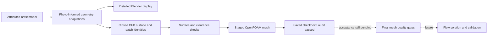

# Engineering notes

## Geometry to a CFD case

The visible model retains visual detail and textures. The CFD surface is separately repaired and simplified where needed for an external-flow approximation. Recorded hashes and embedded geometry checks associate those artifacts without pretending that every visible detail is represented identically in the solver surface.

The final surface record reports 7 patches: `body`, `frontWing`, `rearWing`, and four wheel patches. The floor is included within the body patch in this accepted surface.

## Physical reconstruction choices

The rear-wing study first replaced thin central artist skins with closed physical sections. The 17 October correction then reduced the central flap chord angle from about 75.8 to 45 degrees and reshaped the mainplane, rolled ends and support together. The current section chart documents that incidence correction. The old volume checkpoint and refinement boxes cannot be reused for this shape. Nominal section thicknesses and internal details are reconstruction assumptions; perspective photographs cannot establish exact aerodynamic profiles.

The diffuser work addresses the floor transition, roof, outer walls, and central spine. References span several 2023 events. They support visible shape features but do not establish a single exact race trim or hidden internal geometry.

Tyre contact treatment, sealed openings, and the absence of brake-cooling/exhaust mass flow are external-aerodynamics approximations. A closed surface is a meshing prerequisite, not a test of physical fidelity.

## Recoverable meshing under a memory budget

The local workflow uses explicit finite per-job memory and swap limits, Windows-host headroom checks, and stage-level stop conditions. Resource limits are chosen before launch; the controller does not silently expand an active job's allowance. Mesh-refinement forecasts and saved checkpoints help avoid discarding all progress after an interrupted stage.

MPI output order is especially important: one rank may finish writing after another rank has already printed the next refinement step. The included [checkpoint parser](../src/checkpoint_log.py) therefore matches each rank's first native subset write with that same rank's completion and requires a common saved time. It ignores an unterminated final log line.

The parser's result is only a log-level signal. Native mesh metadata, complete files for every rank, geometry/input identity, and the absence of active writers must be checked independently before a checkpoint is accepted. The public tests use small synthetic log fragments and never start a solver.

## Reference links

Photographs are linked for attribution and context; image files from these sources are not redistributed here.

- [Bahrain testing technical detail](https://www.motorsport.com/f1/news/f1-team-tech-2023-test-bahrain/10436662/) — Giorgio Piola / Motorsport Images; rear-wing shape reference.
- [Bahrain 2023 testing gallery](https://espanol.motorsport.com/f1/news/galeria-fotos-formula1-test-bahrein-2023/10435388/) — Motorsport Images; rear views.
- [Miami 2023 pitlane technical gallery](https://www.motorsport.com/f1/news/miami-gp-f1-technical-images-pitlane-explained/10465362/) — Giorgio Piola / Motorsport Images; diffuser reference.
- [Spain 2023 pitlane technical gallery](https://espanol.motorsport.com/f1/news/galeria-tecnica-detalles-f1-pitlane-espana/10476961/) — Giorgio Piola / Motorsport Images; diffuser reference.
- [Exposed RB19 floor after the Monaco incident](https://www.motorsport.com/f1/news/red-bull-f1-car-floor-exposed-williams/10482802/) — Motorsport Images; underfloor reference with perspective and damage limitations.

The primary artist model and its reuse terms are recorded in [ATTRIBUTION.md](../ATTRIBUTION.md).
